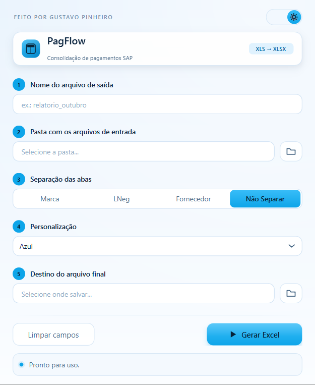
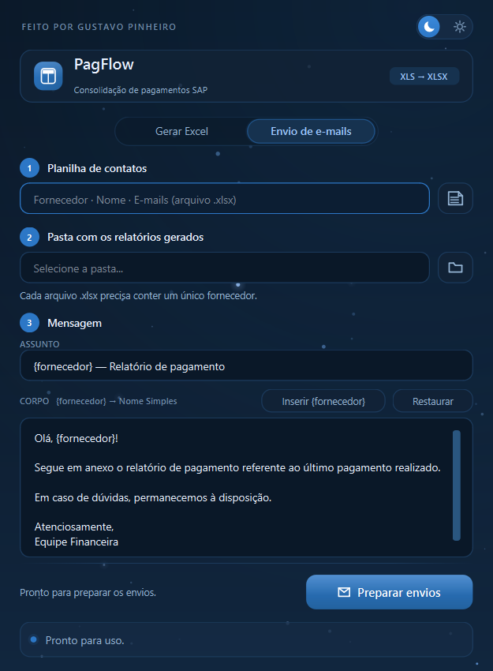

# PagFlow

Aplicativo desktop para consolidação e exportação de relatórios de pagamento de transportadores a partir de extratos do SAP.

---

## Visão geral

O PagFlow Excel lê arquivos `.xls` exportados do SAP (texto separado por tabulação, codificação UTF-16), identifica automaticamente o tipo de relatório, aplica o tratamento de dados adequado e gera um único `.xlsx` formatado e pronto para análise ou envio.

O diferencial está em aceitar simultaneamente dois layouts de relatório SAP diferentes na mesma execução — o extrato de fornecedor (FBL1N) e o log de pagamentos (REL_LOG) — sem que o usuário precise separá-los previamente.

---

## Interface

A interface é construída em **PyQt6** e trabalha com dois temas completos, alternados pela chave no canto superior direito. A escolha é lembrada entre execuções.

| Tema escuro | Tema claro |
|---|---|
|  |  |

**Tema escuro** — céu noturno em azul-marinho, com estrelas pequenas em tons de azul que crescem e diminuem lentamente, e destaque no azul da marca.

**Tema claro** — a mesma composição em céu diurno: fundos claros, textos em azul-marinho e o azul-celeste como cor de destaque.

A geometria é idêntica nos dois temas (campos de 32 px, cartões de raio 12): a troca altera apenas as cores, as sombras e o céu. A janela assume a proporção **4:3** e é dimensionada na abertura para o maior retângulo que caiba na área útil do monitor (com teto de 1280 × 960), reencaixando-se se for movida para outra tela.

---

## Pré-requisitos

- Windows 10 ou superior
- Não é necessário ter Python instalado — o aplicativo é distribuído como executável (`.exe`)

---

## Instalação

Execute o `instalador_flow.exe`. É comum que o Windows exiba um aviso de segurança ("fornecedor desconhecido") em ambientes corporativos. Clique em **Mais informações** e depois em **Executar mesmo assim** para prosseguir.

> 🚀💸 **[Baixar PagFlow](https://github.com/ItsGlutos/rel_pgto_CustosSC/releases/download/2.1/instalador_flow.exe)** — Windows 10+
---

## Como usar

A interface é dividida em cinco campos de configuração, preenchidos antes de iniciar o processamento. A chave no topo alterna entre o tema escuro e o claro a qualquer momento — nenhum campo é perdido na troca.

**Nome do arquivo**
Define o nome base do `.xlsx` que será gerado, sem extensão.

**Pasta de origem**
Pasta onde estão salvos todos os arquivos `.xls` a serem processados. Todos os arquivos da pasta são lidos de uma só vez — FBL1N e REL_LOG podem coexistir sem problema.

**Separar abas por**
Define como o relatório final será organizado internamente:

| Opção | Comportamento |
|---|---|
| Marca | Uma aba por empresa (ex: Santa Cruz, Panpharma) |
| Fornecedor | Uma aba por código de fornecedor |
| LNeg | Uma aba por local de negócio |
| Não Separar | Todos os dados em uma única aba |

**Cor do relatório**
Personalização visual da tabela: Azul, Verde, Roxo ou Vermelho.

**Pasta de destino**
Onde o `.xlsx` final será salvo.

Após preencher todos os campos, clique em **Gerar Excel**. Enquanto o processamento roda, a barra de status mostra o progresso e o botão fica desabilitado para evitar execuções simultâneas.

---

## Envio de e-mails

A segunda tela, **Envio de e-mails**, dispara pelo Outlook Desktop os relatórios já gerados pelo PagFlow. A troca entre as duas telas é feita por um seletor mínimo no topo da janela (duas palavras e uma pílula que desliza): ao trocar, a tela atual se dissolve e a outra assume o mesmo lugar, como se o usuário tivesse mudado de janela dentro do programa. Nada rola, nada é reflowado e a janela não muda de tamanho — só o conteúdo se dissolve, em 240 ms.



O fluxo é:

1. **Planilha de contatos** — um `.xlsx` com as colunas `Transportadora`, `Fornecedor` e `E-mail(s)`. A `Transportadora` traz o *Nome Simples* e o `Fornecedor` traz o código; o cruzamento entre os dois é feito como um *procv* (código → Transportadora), e é esse nome que entra automaticamente no e-mail através da variável `{fornecedor}`. Quaisquer outras colunas da planilha são descartadas.
2. **Pasta com os relatórios** — o usuário indica a pasta com os `.xlsx` gerados; o PagFlow abre cada arquivo e localiza a coluna **Fornecedor** em **todas** as abas.
3. **Validação** — um transportador pode ter vários códigos de fornecedor; o arquivo pode conter todos eles, desde que não reúna transportadoras diferentes. Caso reúna, a linha é bloqueada e sinalizada na tabela de revisão.
4. **Confirmação** — uma janela mostra cada arquivo relacionado à sua Transportadora e destinatários, com a pergunta *"Tem certeza que deseja enviar X e-mails?"*. A coluna **Avisos** exibe os totais de bloqueio e CFD que entrarão no corpo. Somente os grupos marcados são disparados.

O assunto e o corpo são editáveis (o corpo tem um padrão sugerido e pode ser restaurado). O envio é feito um e-mail por arquivo, com o relatório anexado, usando `pywin32` + Outlook Desktop — a mesma lógica do projeto de referência `ins_dashboard_app`.

O corpo é complementado automaticamente, antes da despedida, quando o relatório traz essas informações:

- **Bloqueios** — se a coluna `BlP` (FBL1N) ou `BIP` (REL_LOG) indicar bloqueio com `B`, o e-mail informa quantos documentos estão bloqueados e o valor total bloqueado.
- **CFD** — se houver documentos do tipo `KT`, o e-mail informa o valor total de CFD (Confissão de Dívida) e a quantidade de documentos.

Os valores são somados em módulo (sempre positivos) e consideram todas as abas do arquivo. A assinatura padrão é **Time Fretes - Distribuição Farma**.

---

## Pipeline interno

```
Arquivos .xls (pasta de origem)
        │
        ▼
  detectar_relat()
  ├── Lê as 7 primeiras linhas (UTF-16)
  ├── Presença de "Nome" → Tipo A (FBL1N), skiprows=8
  └── Ausência de "Nome" → Tipo B (REL_LOG), skiprows=3
        │
        ▼
  tratamento_fbl1n() ou tratamento_log()
  ├── Remove colunas "Unnamed" e colunas desnecessárias por índice posicional
  ├── Preserva a coluna de bloqueio (BlP/BIP) pelo cabeçalho
  ├── Renomeia colunas para esquema padrão unificado
  ├── Converte campo "Valor" via parse_sap_valor()
  │   └── Trata sinal negativo no fim da string (padrão SAP de créditos)
  ├── Converte tipos: texto, Int64 e datetime (dd/mm/yyyy)
  ├── Filtra apenas os tipos de documento: RE, KT, RF
  └── Reanexa o bloqueio como coluna "Bloqueio" ao final do esquema
        │
        ▼
  Concatenação de todos os DataFrames tratados
        │
        ▼
  exportar_excel()
  ├── Separa em abas conforme opção escolhida
  ├── Aplica formatação: zebrado, cabeçalho colorido, bordas
  ├── Destaca linhas KT em vermelho com fonte branca
  ├── Adiciona linha de subtotal com fórmula SUM na coluna Valor
  ├── Ajusta largura de cada coluna automaticamente
  └── Salva via arquivo temporário → move atomicamente para o destino
```

---

## Estrutura do repositório

```
.
├── main.py          # Interface gráfica (PyQt6) e ponto de entrada
├── ope.py           # Orquestração: leitura da pasta, concatenação e chamada de exportação
├── funcoes.py       # Lógica de negócio: detecção, tratamento e exportação
├── envios.py        # Envio dos relatórios por fornecedor via Outlook Desktop
├── requirements.txt # Dependências para rodar a partir do código-fonte
├── docs/            # Capturas dos dois temas
└── PagFlow.spec     # Configuração do PyInstaller para geração do executável
```

---

## Desenvolvimento

Requer Python 3.10 ou superior.

```bash
pip install -r requirements.txt
python main.py
```

O `main.py` cuida apenas da interface: temas, céu estrelado, controles e a barra de status. A execução continua sendo delegada ao `ope.executar()` — o mesmo caminho usado pela linha de comando do `ope.py`.

---

## Tipos de documento processados

| Tipo | Descrição |
|---|---|
| KL | Fatura |
| RE | Documento Contábil |
| KT | Confissão de Dívida (CFD) |
| RF | Nota Fiscal da Seguradora |

Linhas com outros tipos de documento são descartadas no tratamento.

---

## Observações técnicas

Os arquivos `.xls` exportados pelo SAP neste contexto não são planilhas binárias reais — são arquivos de texto com separador de tabulação e codificação UTF-16. A leitura é feita com `pandas.read_csv` e não com `read_excel`, justamente por isso.

Valores monetários no SAP podem vir com o sinal de menos no final da string (ex: `1.500,00-`), formato que o pandas não converte nativamente. A função `parse_sap_valor` trata esse caso antes da conversão numérica.

O arquivo `.xlsx` é escrito primeiro em um caminho temporário e só é movido para o destino final após a conclusão, evitando que o usuário veja um arquivo corrompido ou parcialmente escrito.

A coluna de bloqueio tem nome diferente em cada layout: `BlP` no FBL1N e `BIP` no REL_LOG. Como ela fica em uma posição que o tratamento descarta, o PagFlow a localiza pelo cabeçalho antes dos descartes e a devolve ao final do relatório como **Bloqueio**, preservando o valor original do SAP (`B` para bloqueado, `S`/branco para sem bloqueio).
